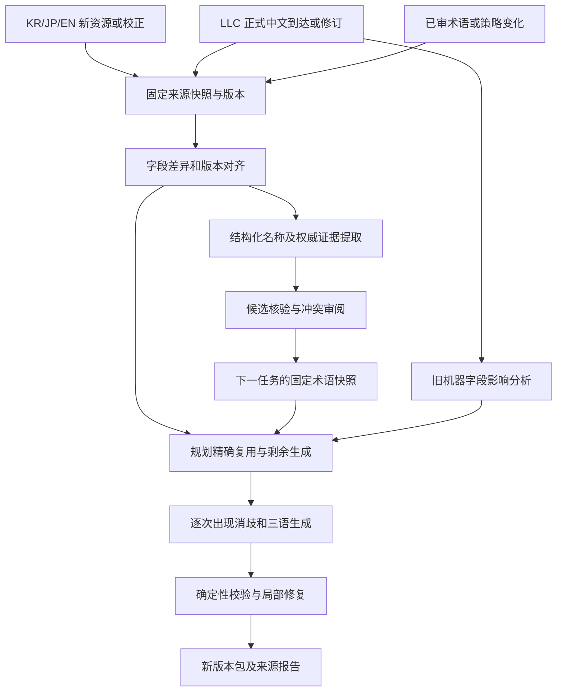

# LCTA 后续功能与重构总路线图

> 2026-09-29，`v0.1-plan`。本次只读调查与设计，只新增 `docs` 计划文件；没有实施代码、配置、词表、数据库、工作流、benchmark 或发布变更。文中的目录和接口均为未来方案。

## 1. 建议与阅读入口

建议把本项目演进为“**三语证据驱动、权威中文优先、可追溯修订的增量本地化系统**”。重点投资字段版本对齐、权威词库自维护和中文迟到后的修订闭环；翻译模型与 Jev 成为可替换的生成/判定组件。

允许为此大范围改造：停止把机器新词回流和优先文件的机器中文当后续术语；抽出统一领域内核，逐步替换 `FileProcessor` 的多职责控制流，并在验证完成后结束本项目对旧核心的整目录覆盖式同步。

| 文档 | 内容 | 适合先看什么 |
|---|---|---|
| 本文 | 功能范围、架构决定、更新双流程、持久化、发布策略 | 整体方向和改造边界 |
| [术语账本 v2](2026-09-29-term-ledger-v2-spec.md) | 维护格式、schema、权威资格、候选隔离、旧表迁移 | 词库如何自己维护 |
| [三语流水线与 Jev](2026-09-29-trilingual-pipeline-and-jev.md) | 字段对齐、三语分歧、TM、occurrence、Jev、局部修复 | 如何利用 KR/JP/EN 优势 |
| [迁移与验收](2026-09-29-migration-validation-plan.md) | 工作包、依赖、数据迁移、实验、门槛和回滚 | 后续开发的任务拆解 |
| [设计依据与取舍](2026-09-29-design-evidence-and-decisions.md) | 当前代码事实、旧文档修正、16 个项目采用矩阵 | 为什么这样选，哪些建议不照搬 |

所有性能改善和质量增益待验证。旧报告中的存量对齐率、504 次数和模型测试成绩不作为本次实测或未来承诺。

## 2. 项目独有的约束

| 本项目情况 | 产品要求 |
|---|---|
| 同时拥有 KR/JP/EN 平行文本 | 对齐和证据贯穿召回、消歧、生成、校验；不是仅在 prompt 附上三列 |
| 权威中文略晚于原文 | 原文更新和中文更新是独立事件；中文到达后即使 raw token 没变，也要重新规划 |
| 自己的机译只是补缺 | 机译专名不能作为其他字段/未来任务的词表、TM、角色名或示例依据 |
| 旧术语表停止更新 | 从可核验的权威语料、结构化名称及人工审阅建立自有维护链，不再依赖远程旧表长期增长 |
| 同名多义、同实体多称呼 | 稳定实体＋sense＋scope；不以 KR 字符串为全局唯一键 |
| 游戏字段对 ID、标签、数值敏感 | 可证明的结构规则先行；相似句不得自动当作完全相同句复用 |
| Actions 是临时环境 | 决策、词库、证据和任务进度必须持久化；缓存和七天诊断 artifact 不充当主存储 |
| 持续发布给玩家 | 新权威带来的修订进入新包；保留历史 Release 的内容和解释依据 |

本计划中的“权威”指项目采用的都市零协会／LLC 正式中文来源，不将其混称为游戏开发商官方中文。

## 3. 不可绕过的行为规则

1. **源身份先于复用**：同路径和非空中文不构成版本对应证明。直接使用中文须有来源资格、原文对应关系和范围依据。
2. **候选隔离**：机器创造的译名默认不进入任何后续翻译提示，连弱建议也不例外。人觉得合理或 Jev 高分都不等于权威证明。
3. **抽取不等于创作**：模型抽取真实权威中文可成为待审证据；程序必须核对中文 span 和 authority snapshot，之后走明确准入。
4. **固定快照**：一次任务只读同一套词库、authority、三语和策略。并发先完成的文件不得改变后来文件的定译。
5. **强约束有作用域**：必用/禁用译名都绑定 entity/sense/occurrence；一个误匹配不得使整文件禁用同词。
6. **未知可表达**：三语不齐、版本不明、对齐冲突、无权威译名均有明确状态。不得把低 confidence 或缺数据默认为适用。
7. **生成无权修改权威**：确定复用的权威字段不在模型可编辑集合中；新生成和修复都要验证 ID、旧值和结构。
8. **权威可修订**：权威译名变化需要使依赖旧绑定的机器结果失效；历史 snapshot 仍保留用于解释过去产物。
9. **质量报告和强错误分开**：猜测性的文风/术语问题进入 Review；只有明确结构反例或可证明适用的权威规则才阻断该结果。
10. **失败可恢复**：传输重试、内容修复、延期与源文回退分别计量；不能以“有一个文件成功”代替全包质量判断。

未知的新实体仍可在当前字段产生临时机器译文，但只作为待发布文本与候选诊断。没有权威依据时，无法同时保证所有新名跨文件永久一致；计划通过联合场景翻译、异译报告和后续权威收敛降低影响，绝不靠偷偷建立机器词表解决。

## 4. 功能目录与完成后的行为

| 编号 | 功能 | 用户可观察的结果 | 优先级 |
|---|---|---|---|
| F01 | 原文/中文快照与双事件触发 | 同 raw token 的中文补齐和修订不会被跳过 | P0 |
| F02 | 字段逻辑身份、三语和时间对齐 | 明确哪些日英可参考、哪些缺失/落后/错位 | P0 |
| F03 | 来源认证的权威精确复用 | 已确认中文直接采用，可看命中依据，减少生成调用 | P0 |
| F04 | Term Ledger v2 与冻结编译 | 维护多语名称、义项、范围、证据、历史 | P0 |
| F05 | 候选隔离和维护队列 | 新词可以发现和保留，却不能自动影响后续翻译 | P0 |
| F06 | 统一 span 消歧与术语落位 | 同一句中同词不同义可分别处理，错用可定位 | P1 |
| F07 | authority 到达后的影响索引 | 列出所有受影响机器字段，定向修订并报告覆盖率 | P1 |
| F08 | Jev 影子实验与选择性上线 | 按类别呈现误用、遗漏、弃权、费用和延迟 | P1 |
| F09 | 场景、角色与文风证据 | 剧情、角色语音、播报均能使用局部有效的角色事实 | P2 |
| F10 | 离线 QA 和有界局部修复 | 结构、术语、数字、引用错误有明确分类和处理范围 | P0/P1 |
| F11 | 检索例句与重复句复用 | 只采用有权威来源、范围相符的既有表达 | P1 |
| F12 | 来源报告和可复现发布 | 能回答某个字段从哪里来、用了哪版规则、为何后来修订 | P0 |

P0/P1 是依赖优先级，具体开发顺序见任务 W0-W8；不代表所有 P0 必须一次性大切换。

## 5. 架构选择：独立领域内核，分阶段替换

### 5.1 三种方案的判断

| 方案 | 优点 | 代价 | 选择 |
|---|---|---|---|
| A 仅在 auto_update 外挂审计与词表 | 上手快、与旧同步约定一致 | 无法可靠消除核心内热更新/角色回流，也难保留 span 和阶段状态 | 只用于前期只读报告 |
| B 新建独立本地化内核，保留旧实现做对照 | 对齐、来源、术语和生成有统一契约，可逐段替换 | 需要新接口、迁移和旧测试适配 | **推荐主线** |
| C 一次性完全重写并删除旧核心 | 最自由 | 无可回放基线时风险大，可能丢失已有字段覆盖和标签处理 | 不作为首次实施方式 |

用户允许设计破坏性重构，因此不再把 README 的整目录同步约定当成无法变动的前提。实施到 B 的正式切换阶段时，明确更新 README/架构声明，采用按提交审阅移植上游改进；不能一边大改核心，一边继续声明可整体覆盖同步。

### 5.2 拟议目录与责任

```text
src/auto_update/                # 来源发现、下载、任务编排、发布清单
src/localization/
  domain/                      # TranslationUnit / Evidence / Term / Lineage
  ingestion/                   # 来源策略、快照、字段解析、对齐
  terminology/                 # 维护格式、候选、编译、范围解析
  retrieval/                   # 精确 TM、authority 例句
  decisions/                   # 规则、Jev、生成式判定器
  translation/                 # 任务装箱、生成 provider、局部修复
  quality/                     # 结构/术语/语义风险分类
  reconciliation/              # 权威迟到、撤回、影响图、修订规划
  storage/                     # artifact/SQLite/事务实现
src/translateFunc/              # 迁移期间保留的旧实现，受控对照
terminology/                   # 已审词库和来源策略，文本文件入 Git
tools/knowledge/               # 迁移、候选审阅包、lint/compile/impact
evaluation/                    # 评测代码、小型夹具和数据清单
```

保留有效算法与接口，如 AC 召回、字段覆盖、富文本处理、错误记录、下载和打包。没有证据需要改 Steam 状态服务或整个下载栈；大改集中在领域数据模型和翻译控制流。

### 5.3 模块输入/输出契约

| 组件 | 输入 → 输出 | 允许改变的状态 |
|---|---|---|
| SnapshotStore | 已抓取资产＋元数据 → SourceSnapshot | 只追加、按哈希去重 |
| AlignmentService | snapshot＋解析规则 → Unit/Evidence | 新的对齐 revision，不覆盖历史 |
| TermCompiler | 已审词条＋authority evidence → TermSnapshot | 只生成不可变快照，不能直接批准候选 |
| ReuseResolver | unit＋authority index → accepted/ref/no_match/conflict | 无副作用 |
| OccurrenceResolver | unit＋terms → ResolvedOccurrence[] | 保存决策，不改词库 |
| TranslationPlanner | unit＋context＋决策 → 稳定 JobPlan | 先确定可编辑集合，不受 worker 完成顺序影响 |
| Generator/Repairer | JobPlan → MachineCandidate/EditProposal | 无写库、发布或改权威权限 |
| Validator | candidate＋源/约束 → 四类 findings | 不静默修改已接受文本 |
| Reconciler | authority/term diff＋dependency index → RevisionPlan | 使旧机器结果过期；只生成待执行修订 |
| PackageAssembler | accepted fields＋schema → game JSON＋manifest | 以当前 KR 结构写回，拒绝缺字段和旧版本结果 |

同一验证入口覆盖新生成、重试修复、缓存恢复和权威复用，规则按来源区分，不能让“来自缓存”绕过新 term revision 检查。

## 6. 两条更新流程



### 6.1 原文更新

下载并验证三语 → 对比字段与结构 → 记录新实体/分歧 → 使用本任务开始前已冻结的有效权威词条 → 当前缺译联合生成 → 校验 → 保存来源与依赖 → 发布合格新包。

新机器专名只进隔离队列；包括优先翻译的角色和状态效果中文也不回灌。英文/日文新别名可以形成 source-only 证据，但如果实体链接本身不确定，同样需审阅。

### 6.2 权威更新

发现新的正式中文资产或中文内容哈希变化 → 对齐它适用的原文版本 → 保存权威句对和名称证据 → 编译合格的新词库 snapshot → 生成影响集合 → 精确替换已有权威整字段，其他相关机器字段局部修订 → 验收 → 产生新包。

独立触发来源优先采用 authority Release 事件/可用 webhook；没有该事件能力时规划定期检查或手动“同步权威”入口。**本次没有创建定时任务。** 无论哪种入口，都先检查 raw 与 authority 的完整版本，再决定幂等跳过。

### 6.3 版本对应的困难与默认处理

正式 Release 只证明中文发布身份，不一定告诉我们它对应哪一份原文。优先使用明确提交/资源版本关系；其次使用已验证历史字段与原文不变链。仅路径/ID 相同或时间相近不能直接通过。

初次导入无法证明版本关系的存量，保留为 `source_version_unknown`；先人工核验高频结构化名称和代表性样本。未知中文可在维护界面作待审参考，不自动导入 authority TM。初期覆盖率可能低于旧流程，必须报告原因，而不是伪造高命中率。

默认 authority 来源策略：采用指定 LLC 仓库的正式非 draft、非 prerelease 上传资产，固定 asset ID/内容哈希与对应 ref；普通 commit 只用于变化发现和待审证据。拒绝已识别的原文回填、本项目机器产物和不被该策略接纳的混合来源。策略由人工维护且有版本；材料无法区分字段来源时不自动升格，先列为 source-qualification 待办。

## 7. 持久化、并发与幂等

### 7.1 数据归属

| 内容 | 建议持久位置 | 规则 |
|---|---|---|
| 已审词条、来源策略、维护决策 | Git 中 terminology 文本目录 | 代码生成 proposal，维护者合并后生效 |
| 三语/中文证据、候选、lineage、运行检查点 | 独立 `knowledge-v2-<hash>` 快照资产 | 同仓库可用独立命名的非玩家知识 Release；明确排除于玩家版本列表和 latest 选择 |
| SQLite / AC / FTS | 本地临时目录或缓存 | 可从 manifest 和内容重建；校验后使用 |
| 玩家包 | 日期序号 Release | 只含游戏所需文本与最小版本信息；大证据/候选另存 |
| 诊断 | Actions artifact | 便于查错，有期限；不是主存储 |

每个知识快照 manifest 包含所有文件/分片 SHA、父快照 ID、schema、生成工具版本及输入 source IDs。保存本次实际消费的原文/中文内容，不能只存会变动的 URL。小规模先压缩全快照，测出大小和构建耗时后再引入分片/增量去重。

若使用同仓库知识 Release，默认设置 `prerelease=true`、`make_latest=false`，玩家枚举还要显式限定日期序号 tag；知识加载器按精确 snapshot ID 读取，不调用通用“最新 Release”接口。大语料能否随资产分发需沿用其来源许可，不能把外部参考项目代码/数据直接复制进玩家包。

### 7.2 事务与恢复

- 编译器唯一写入、翻译 worker 只读；candidate append 和机器结果存储不得改本轮 terms。
- 先上传临时快照资产并校验完整，再推进 durable manifest 指针；不要先指向半写入文件。
- 采用父 snapshot 的 compare-and-swap；两个运行竞争提交则后者重新计算，不覆盖新证据。
- 任务状态 `planned/running/validated/assembled/published/failed/deferred`；记录 provider attempt ID，避免失败重试被计作多份证据。
- 网络调用无法保证绝对 exactly-once；内容缓存与任务检查点用于减少重复调用，提交和发布则必须幂等。
- 源/术语/策略指纹变化即生成新任务；同一冻结任务恢复可回用已验证的机器字段。机器结果不作为跨任务通用 TM 或术语。

### 7.3 完整幂等键

```text
plan_key = SHA256(canonical(
  raw_source_snapshot_ids + raw_content_hashes,
  authority_snapshot_id + authority_content_hashes,
  term_snapshot_id + style_snapshot_id + source_policy_version,
  parser/alignment/normalizer/validator/prompt_versions,
  generator_model_and_settings + decision_model_and_settings,
  code_revision + packaging_profile
))
```

密钥、运行时间和临时路径不进 key。显式 nonce 可用于有意重跑同配置实验；不能让研究重跑被误判为同一生产结果。输出另有 `artifact_hash`，不把生成的非确定性正文倒灌成任务输入键。

raw token 相同但 authority/术语/资产改变必须重新规划；所有输入相同且已有完整合格包才跳过。未发布/部分失败的同 key 任务是恢复，不是成功去重。

## 8. 权威修订的影响计算

保存两类索引：

1. `use_edges`：字段使用过的 term revision、TM 记录、例句、角色/风格事实、occurrence 决策；支持传递影响。
2. `source_occurrence_index`：所有 source-only 实体与潜在 forms 在原文中的位置，包括没有中文 binding 的新名和曾被 exclude/unknown 的候选。

第二类不可省略：新权威译名出现时，旧字段可能根本没有用过某个 term，单看“使用过旧词条”会漏掉它们。影响集合为已用依赖、原文重新匹配、新/改 scope 命中和实体关联变更的并集；索引缺失则执行带预算的全量源字段扫描，宁可扩大候选集也不直接改中文子串。

为每个受影响字段生成动作：`replace_with_authority/revalidate/retranslate/no_change/conflict/obsolete_source`，附 before/after、证据和原因。只有机器字段可被生成式修复；authority 字段的内部不一致进入权威冲突队列。

任务运行中来了新 authority，当前任务仍保持冻结；发布前比较最新 authority head。若相关关键实体已变化，当前候选进入 stale 队列并让修订任务接续，不能永久把旧包标为最新。

## 9. 发布与失败策略

- 继续沿用玩家 `YYYYMMDDNN` 版本格式，新增完整 plan/knowledge IDs 到元数据。
- 新 authority 或术语修订导致内容改变时，即使 raw token 相同也生成新的日期序号版本，避免静默覆盖历史包。
- 手工恢复完全相同 plan 的失败上传可复用同 tag；人工实验/内容变化不能仅按 raw token 复用旧 tag。
- 已确认结构损坏、错误 ID 对齐或来源越界阻断发布。缺 authority 不是故障；未知术语按策略生成临时译文并报告。
- 内容生成耗尽可对允许类型保留当前 KR 原文，标 `fallback_source`；关键名称/严重机制风险的 fallback 上限由数据基线确定，未确定前不把它们当正常完成。不得复用已经失效的旧机器中文来掩盖失败。
- 发布摘要显示 authority 复用、生成、回退、待审、权威修订覆盖和来源缺失数。诊断中存在 Review 不自动等同发布失败。

## 10. 分期目标与暂缓项

| 里程碑 | 主要工作包 | 可交付能力 |
|---|---|---|
| M0 可核验底座 | W0、W1 | 当前事实清单、源版本/字段对齐、冻结回放 |
| M1 自有权威术语 | W2、W3、W4 初版 | 合格 authority 复用、词库维护、候选隔离、离线审计 |
| M2 三语生成新内核 | W5、W6 | 统一 occurrence、三语分歧处理、Jev 选择性决策、局部修复 |
| M3 权威迟到闭环 | W7 | 独立中文触发、影响计算、定向修订和持久化恢复 |
| M4 切换与治理 | W8 | 新发布语义、回滚验证、旧同步契约退役 |

现在不要求向量数据库、多代理生成投票、完整 Web 平台或无限自动精修。未来若词面检索在已标注例句集上的召回确有不足，可以单独对比向量检索；它只能扩展 L2 参考，不能绕过权威和精确复用条件。

计划默认不把待决事项变成开工前必须逐个询问用户的问题。实现可先按本文默认值建立只读索引、schema、夹具和报告；来源资格不明的数据保持隔离，真实模型预算、外部事件渠道和生产发布切换在对应实施阶段确定。
