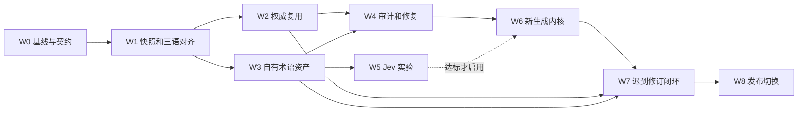

# 后续实施任务、迁移顺序与验收方案

> 2026-09-29，只读计划，未执行这里的开发、测试、迁移或发布操作。返回[总路线图](2026-09-29-future-capability-roadmap.md)。所有工期、样本规模、预算和阈值是规划初值，不是已达成结果。

## 1. 实施依赖与开工顺序

W5 不得阻塞其他功能：Jev 不达标仍可用统一契约的规则/生成式判定器继续 W6/W7。W2 与 W3 在接口固定后可独立开发，实际代码改动需避免同时修改同一旧核心。本计划没有要求或启动子代理。

建议首先形成四个可单独审阅的实施变更：现状契约和可回放夹具 → 稳定字段身份/版本对齐 → authority 来源与精确复用 → 词库格式/候选隔离。前几步只输出报告即可验证，不需要先调用模型。

## 2. 工作包定义

### W0：当前基线、行为契约与可靠性

**目标**：知道当前系统真实行为，并为后续对照建立可回放输入。

- 列出当前已实现的 retry escalation、字段覆盖、规则修复、Jev 分支与已知失败；历史 22 次 504 仅作故障注入素材，不宣称当前还有完全相同问题。
- 保存小型脱敏/合成夹具及版本清单，覆盖旧字段新增子字段、状态效果变体、角色 ID、原文回填、富文本与占位符。
- 恢复/重建可版本化评测代码至 `evaluation/`；本地 benchmark 中只有字节码的内容不能声称已得到原源码。大语料与产物继续用 manifest 引用。
- 固定 `RunContext`、任务状态、source/term/prompt/model 指纹和错误类别；transport、parse、content、invariant 分开。
- 盘点生成 provider 内部重试，统一服务退避与内容重试的总预算，避免两层重试相乘。

**预计改动**：未来 `evaluation/`、小型测试夹具、新 domain/diagnostic 契约；必要时适配 `translatekit`，不先重写 prompt。

**完成条件**：离线能重放“相同输入得到相同字段集合/任务计划/检查结果”；有网络生成的正文只保证保存原输出后可重放，不承诺重调模型逐字一致。对故障注入的 429/504/timeout 能单独记重试、恢复与耗尽，不再误报为术语质量退步。

**依赖/工作量初值**：无；2–4 人日，若评测代码需重建另计。

### W1：来源快照、逻辑字段和三语对齐

**目标**：可证明日英/中文与哪一段 KR 对应。

- 为 raw 三语与 cooked 资产建 SourceSnapshot，保存实际内容和资产 ID/哈希；下载重传、同 tag 内容变化都可识别。
- 调查各文件类别的稳定键，建立按类型注册的 parser；名称、描述、对话、引用数据分开。
- 用稳定 ID/嵌套键和原文 hash 建 TranslationUnit；区分 logical identity 与当前 JSON Pointer。
- 改善角色顺序配对；对效果变体的同 ID 冲突保留 domain，消除先到先得。
- 剧情插行、数组重排、缺失 JP/EN、不同版本对照输出 candidate/conflict，不强行凑齐。
- 建 authority 适用版本证明：明确版本映射或原文不变链；没有证明的存量列 `source_version_unknown`。

**交付**：对齐 JSONL、字段类型/覆盖报告、版本对应报告、source-only 实体索引、稳定 ID 测试集。

**完成条件**：已知插行/重排/重复 ID 夹具零误配；缺语言不复制 KR 充数；无证据不会进入 verified。人工抽检分剧情/技能/名称等给出精确率和区间，未达门槛的类别保持候选模式。

**依赖/工作量初值**：W0；4–7 人日，历史版本关系调查另列数据风险。

### W2：有来源的 authority TM 与字段 lineage

**目标**：先可靠复用权威，再生成剩余字段。

- 实现 authority 来源策略与资格校验；普通提交、旧术语表、机译和 raw 回填不自动成为 authority。
- L0 当前字段精确复用；L1 跨字段同原文复用增加实体/语境/结构签名约束；L2 例句只作参考。
- authority 内同源不同译按 scope 保留；冲突不以频数或“最新文件顺序”选择。
- 字段结果保存 lineage 与所有复用证据；从旧流水线兼容投影时来源不明标 unknown。
- 让 authority 字段从可编辑集合排除；无匹配中文才进入机器生成。

**交付**：只读 authority 索引、命中报告、字段来源报告及“不调用 provider 的复用路径”测试。

**完成条件**：数字/否定/引用不同、源版本不明、机器来源等反例不允许直接命中；确认命中字段逐字等于 authority；不会把全库存量覆盖率当本次增量命中率。

**依赖/工作量初值**：W1；3–5 人日。

### W3：Term Ledger v2 与旧表退出

**目标**：拥有可维护的术语真源，且所有机器专名只能作为候选。

- 实现 [术语规范](2026-09-29-term-ledger-v2-spec.md) 的严格 schema、引用/状态/范围校验、编译器与 snapshot hash。
- 导入旧静态表至 `legacy_unverified`；导入 `proper_learned` 至独立 candidates。每条旧记录保留 0/1/N 映射、拆义原因和证据状态。
- 从对齐的权威结构化名称自动提出绑定；正文抽取必须定位中文 span，先走人工审阅。
- 替换 `merge_terms`、热更新和 `_update_roles/_gather_affects` 的来源不分通道；包括缓存、few-shot、摘要中的间接回流。
- 先建立 CLI/Markdown 审阅：四语、来源、旧/新、scope、影响数；接受、拆义、链接、拒绝、等权威。
- 编译运行 snapshot 前统一提交，禁止翻译 worker 修改词库；空库/大量隔离项明确提示。

**交付**：词库 schema/示例、一次性导入报告、维护命令、候选审阅包、通道污染测试。

**完成条件**：无权威证据的机器译名在普通术语、角色、affects、TM、摘要、缓存等全部入口的注入数量为 0；模型从 authority 抽取与自由创造能被不同处理。旧表每条记录都有可追踪归宿；读取旧 learned 文件不重新启用旧规则。

**依赖/工作量初值**：W1；4–7 人日，不含人工核验整个历史词库的时间。

### W4：确定性质量与局部编辑协议

**目标**：知道哪里错、为什么需要审阅、哪些结果必须拒绝。

- 定义 InvariantViolation、TerminologyViolation、ReviewFinding、OperationalFailure、Unverified；退出码由 publish policy 读取，审计器默认只读。
- 同源异译按 entity/sense/context 分组；使用 resolver 相同的 occurrence 和术语规则检查 target。
- 占位符/标签/引用/字段集合确定性检查；可可靠解析的数字/比较操作为硬规则，普通剧情中的疑似语义变化只 Review。
- 精确术语只在“适用且目标位置可证明”时为硬约束；否则 unverifiable/Review，避免词串存在即判通过。
- 实现有限次数最小编辑，校验 before_hash、可编辑 unit ID、旧值和结构；修复回归则保留原机器 draft。
- 建 finding 基线/豁免，豁免必须有 scope、原因、证据版本和失效时间；不可豁免来源污染/字段损坏。

**交付**：`qa-summary`、按字段 findings、离线审阅报告、修复协议和计数。

**完成条件**：检查不静默改译文；结构/权威越权夹具 100% 检出；空词库不能 clean；问题不会因同词其他位置出现了中文而被错误关闭。

**依赖/工作量初值**：W2/W3；3–5 人日。

### W5：Jev 影子实验与按类别启用

**目标**：验证它在哪些判定值得使用，而非重新做一个翻译器。

- 定义统一 DecisionProvider，选择规则、旧 LLM 的 occurrence 适配实现和 Jev。
- 增加 span 级 stable occurrence、unknown/conflict、部分答案处理、版本化缓存、请求拆批和预算/熔断。
- 先只运行 shadow，对比已标注难例；其次尝试 authority 抽取核验和例句排序。
- 每类分别校准自动 apply/exclude 的门槛，不使用单一 0.9 替代 CJK 校准。
- 端点、价格、限制和模型版本在实施时重新核实；报告真实费用，避免复述历史宣传倍数。

**交付**：标注指南/数据清单、分层指标、阈值配置、enable/disable 决策报告。

**完成条件**：批准状态不受 Jev 影响；低 confidence/缺项不会当 applicable；失败回退仍为逐 occurrence；未通过统计门槛的类别保持 shadow。

**依赖/工作量初值**：W3 和 W1 对齐夹具；2–4 人日开发，标注与真实 API 预算独立计。

### W6：领域内核与三语联合生成

**目标**：使来源、三语、决策、生成和校验的契约贯通。

- 建 `src/localization`，旧 FileProcessor 逐段替换为 parser、reuse、resolver、planner、generator、validator、assembler。
- 将“先翻角色/效果再拿输出定名”改为“先读取权威实体知识、冻结、再生成”。
- 任务装箱先依完整原文和场景稳定规划；重试只缩小可编辑集合，保留原场景事实和 source context。
- 外置角色档案/风格规则，覆盖剧情、角色语音和播报；只有已证实事实/权威例句可作为未来上下文。
- 多语分歧、缺失、stale 进入结构化输入；三语并列推理默认一次生成，不机械调用三个模型再投票。
- 复用现有 AC、富文本、字段覆盖和诊断能力；旧功能测试改为契约测试，移除实现细节耦合。

**交付**：新编排 API、兼容旧入口的 adapter、差异报告、预算和场景回归集。

**完成条件**：改变 worker 数量/完成顺序不改变术语 snapshot、字段集合、匹配和 authority 决策；冻结的 provider 输出回放结果一致。真实重新生成可有差异，须量化而非宣称位级确定性。

**依赖/工作量初值**：W0-W4，Jev 可关闭；5–8 人日。

### W7：权威迟到、持久化与定向修订

**目标**：原文不更新时也能向新权威中文收敛。

- 独立 authority 检查/触发；查询 raw 与 authority 后再去重；引入完整 plan_key。
- 保存 source occurrence index 和 use_edges（包括 TM、角色/例句/风格依赖）；新 binding、别名、scope、撤回都产生影响集合。
- 权威整字段到达直接替换候选；其他机器字段局部修订；当前原文已变化则重新对齐，不拿旧 authority 替换。
- 输入变化失效相关判定/生成缓存；新实体虽未曾命中旧词表也可被回溯发现。
- durable knowledge manifest、内容校验、父版本 CAS、任务检查点；Actions 缓存丢失后可重建。
- 中断/并发更新/资产重传/authority 撤回的恢复与回滚流程。

**交付**：RevisionPlan、影响报告、收敛报告、知识快照与恢复工具、authority 独立触发接口。

**完成条件**：同 raw token 的新 authority 会触发；受影响金标字段漏检为 0；没有引用旧 binding 的新词字段也能被发现；中途到达新版本不使旧任务改 snapshot；快照半写入不能被读取为有效。

**依赖/工作量初值**：W1-W4/W6；4–6 人日。

### W8：发布切换、清理和维护交接

**目标**：让新流程可稳定运行，并明确退役旧契约。

- 保留 `YYYYMMDDNN`，引入 plan/knowledge IDs；不同 authority/term 输入生成新版本，同计划断点恢复可复用 tag。
- 明确知识 Release 命名和玩家 Release 筛选，禁止知识快照成为玩家 latest。
- 输出覆盖率、机器临时字段、fallback、待审和收敛情况；来源/结构违规作为阻断。
- 运行影子对照和小范围类型切换，之后扩大；完成真实更新验证与来源审阅再成为默认。
- 更新 README/架构/配置说明：停止“原样同步”承诺；保留上游来源与按提交移植策略。
- 旧配置版本明确拒绝或迁移，不默默忽略 `enable_new_terms` 等已经改变语义的设置。
- 退役旧动态读回、旧格式完整表加载和旧 raw-token-only 幂等，保留迁移记录和历史包。

**完成条件**：下面第 5–7 节全部通过；演练恢复知识快照、撤回新引擎和不覆盖历史包。切换不依赖“连续两次没报错”这一条粗略信号。

**依赖/工作量初值**：W7；2–4 人日，线上观察等待时间另计。

## 3. 破坏性迁移的具体取舍

| 旧行为/格式 | 新行为 | 兼容与退役策略 |
|---|---|---|
| `term -> translation` 单值字典 | 实体/sense/forms/scope 多候选 | 不无损可表示的条目不导出给旧全局表；仅兼容当前字段唯一适用的绑定 |
| `proper_learned` 读回＋热更新 | candidate-only 收集 | 一次性导入后只读归档；旧配置命中时显式迁移提示/错误 |
| priority 文件机器中文建立角色/效果索引 | authority/source-only 实体知识 | 不能只关 `enable_new_terms` 就声称隔离完成 |
| 布尔 `_field_covered` | 带版本证明的 authority binding | 保留缺字段检测；旧覆盖结论无指纹时为 unknown，不假造 |
| 块级术语删除 | span 决策对象 | 旧 fixture 保留作行为对照，生产回退用新对象契约 |
| raw token 去重、同 token 手工覆盖 | 完整输入 key、内容变更新版本 | 旧包 metadata 读取兼容；首次按新 key 重建/导入计划，不能只因旧 raw tag 存在就跳过 |
| 临时目录/七天诊断作状态 | durable knowledge snapshots | 缓存仅加速，任何发布能找到完整 manifest |
| 整目录同步 translateFunc | 独立内核＋审阅上游移植 | 旧源保留到迁移完成；明确切换 README/架构说明，避免下次同步覆盖新代码 |

旧格式兼容期建议至少覆盖两个真实更新窗口与一个中文迟到事件；若相应事件未发生，用可核验历史回放补覆盖。期数不是质量证明，必须同时达到不变量和数据资格门槛。

## 4. 数据集与实验设计

### 4.1 三层数据

1. **确定性夹具**：不调用网络，含所有已知反例与故障注入，提交小数据和标注。
2. **历史 as-of 回放**：选至少三类更新：新内容很多、主要中文修订、数组/剧情结构变化。每次只加载当时已知的 raw/authority/terms。
3. **真实端点小样本**：通过离线门槛后才测模型、Jev、实际延迟费用；扩大量前先写预算和停机条件。

晚到的权威中文可以成为历史回放的评测 gold，但不能提前进入该次运行的词库/TM/例句/风格资料。测试实体、重复句组、章节和更新时间分组隔离，防止同一句复制到另一个文件造成训练/测试泄漏。

过往 `llc_ref`、`Auto GTP Update` 或目录名只作线索；先完成评测中文的权威资格核验，不能用本项目自身机译作为权威答案。

### 4.2 对照轴

| 对照 | 固定内容 | 变化内容 | 看什么 |
|---|---|---|---|
| 旧流程 vs 新基础 | 同 source/authority cutoff，固定 provider 回放 | 对齐/来源/规划 | 字段覆盖、错误复用、候选污染、结构回归 |
| 单语 vs 三语 | 同词库/模型/预算，固定同一数据集 | KR；KR+JP；KR+EN；三语＋分歧规则 | 误套词、机制错误、角色错误、成本与增益 |
| 原判定器 vs Jev | 同 occurrence、三语、候选和标注 | 判定服务 | 错误 apply/exclude、弃权、覆盖、费用 |
| prompt/场景策略 | 相同已保存的 stage-0 输出 | 上下文/提示策略 | 内容质量，避免消歧漂移混杂 |
| 无回流 vs 权威回流 | 同原文、固定晚到 authority | 修订规划/执行 | 影响集合召回、权威覆盖、失效缓存、收敛时延 |

真实生成对照初值重复 3 次，报告配对差异和离散程度；预算不足时明确样本不足，不能用单次 0.x chrF 波动定方向。Jev 的错误/回退是系统质量的一部分，不能只挑成功样本汇报。

### 4.3 指标定义

- `eligible_authority_fields`：来源及版本对应合格、结构兼容的字段数；另报全部待翻字段数。
- path/value hit rate：分别以当前**待处理增量**为分母，另报存量覆盖；不混用。
- authority 保持率：已确认采用的权威字段中，正文保持原值的比例；受控序列化差异另计。
- 错误复用率：人工确认的错误直接复用 / 直接复用样本；给置信区间。
- 术语误用率：错误 apply / 所有自动 apply；漏用率：漏掉的应适用 occurrence / 金标应适用 occurrence。普通词和异义不能混作漏用。
- 候选污染数：无权威依据机器映射通过任一通道进入后续翻译的次数；目标固定为 0。
- scope 内一致率：相同实体/sense/范围的适用 occurrence 是否使用其 allowed forms；不以裸 KR 唯一译法为指标。
- 误报占比：被人工推翻的 findings / 审阅 findings；若要报统计 FPR，则分母改为所有金标阴性位置，二者不混称。
- 修订影响召回：找出的真实受影响字段 / 金标受影响字段；含首次出现中文 binding 的 source-only 实体。
- 收敛率：已更新为合格新 authority 的机器字段 / 本次可修订字段；待审/原文已变的字段单独分桶。
- 可靠性：缺字段、空值、fallback、partial、deferred、传输耗尽分别统计，不能从总结果中删除后声称质量上升。
- 成本：每有效字段的生成、判定、修复、重试总费用；另报缓存命中率、p50/p95 时延、索引构建/恢复耗时和资产大小。

chrF/精确匹配只作辅助。术语正确但句式不同不是自动错误；输出缺失与基础设施失败必须保留在端到端指标中，另有成功字段质量桶用于归因。

## 5. 初始验收门槛

| 能力 | 确定性门槛 | 统计/人工门槛 |
|---|---|---|
| 来源与词库隔离 | 所有污染入口夹具为 0；无证据词条不可编译 | 抽检候选、旧表、角色/效果来源分类无越界 |
| 结构/身份 | 已标注插行/重排/重复 ID 零误配；字段/引用无损坏 | 按文件类型抽检对齐；未知允许存在但必须可见 |
| authority 精确复用 | 所有数字/否定/指纹/冲突反例都拒绝 | 建议自动采纳子集 precision ≥99%，95% 置信下界≥98%；高危机制误复用出现即停该类自动复用 |
| Jev 自动 apply/exclude | 状态/跨度/回退契约全部通过 | 同上精确率目标作为起点，apply/exclude 分开算；必须优于/不劣于同样选择性覆盖下的基线，样本不足留 shadow |
| 术语 QA | 金标结构硬错误 100% 检出；空库 unverified | Review 误报占比起点≤10%；超过先调规则，不靠屏蔽整类问题压数 |
| 权威回流 | 金标影响召回 100%；同 token 不漏触发 | 可自动处理的结构化名称在下一完整同步任务收敛；人工待审项不伪装超时成功 |
| 并发/恢复 | 同冻结输入＋回放结果的计划/包语义一致；半快照不可见 | 真实高负载费用/时延对比在事先设定预算内 |
| 切换 | 关键夹具全部通过，无 unexplained 差异 | 至少覆盖新 raw、中文迟到、术语修订三个生命周期，人工复核高影响差异 |

规划首批约 300–500 个**去重后的**判定位置，至少 100 个短词/多义/分歧难例；这个规模是建立基线的起点，不保证每个类别已满足上述置信区间。类别样本不足就降低自动覆盖，不降低来源规则。统计门槛需在实际成本与错误代价评审后固定；结构和候选隔离的零容忍不因成本而取消。

## 6. 必测端到端场景

| 场景 | 预期结果 |
|---|---|
| T01 同 KR 含人物/比较两个 `이상` | 两个 occurrence，分别定义 sense；不能整块删除或强制 |
| T02 长词内 `사` 与独立地支同现 | 内嵌误匹配被排除，独立词仍可适用 |
| T03 剧情/BUFF 同源异译 | 使用 scope，二者并存；不按出现频数合并 |
| T04 列表插项/角色顺序变动 | 用稳定身份匹配；无稳定键时输出待定 |
| T05 JP/EN 缺失或落后 | 无伪造平行句；不由多数票覆盖最新 KR |
| T06 相同原文、不同说话人/机制域 | TM 不能无条件复用；语境冲突显式 |
| T07 新 raw、无中文、出现新效果 | 可以生成临时字段；效果词表不回流机器中文 |
| T08 中文晚到而 raw token 不变 | 新输入 key；原文匹配的字段采用权威；新包版本变化 |
| T09 权威新名与机译恰巧相同 | 仍新增 authority evidence，不能改机器记录来源冒充 |
| T10 scope 变宽或新别名出现 | 反向索引＋原文重扫发现以前未用该术语的机器字段 |
| T11 旧 TM/摘要含已弃用机译 | 来源检查拒绝；有依赖的派生缓存失效 |
| T12 authority 发布撤回/同 tag 重传 | 以 asset hash 和来源策略识别，冻结旧任务并新规划 |
| T13 Jev 部分答案、超时、非法选项 | 逐题 unknown/回退，不整词误删、不入库 |
| T14 模型修复改了权威字段 | 编辑拒绝，保留 authority 并报告 |
| T15 中途崩溃/并发两任务/缓存清空 | 恢复快照、CAS 保证无覆盖；证据不重复计票 |
| T16 半包成功、关键字段失败 | 不以有输出就发布；按结构/关键字段策略回退或阻断 |
| T17 knowledge 快照 Release 新建 | 玩家 latest/版本号不受影响 |
| T18 不同编排顺序与 worker 数 | 冻结词库/authority/occurrence 相同，机译不因先完成而变权威 |

## 7. 迁移、影子和回滚

### 7.1 迁移前

保存代码 revision、旧词表原文/来源元数据、相关四语输入、已有包 metadata、诊断与候选，生成 hash 清单。真实 API key 不入清单。旧文件不覆盖；本次文档任务没有执行此迁移保存。

### 7.2 影子对照

新引擎先只读输出 plan/report；现有生产行为保持由原实施环境决定。来源隔离安全 adapter 完成后，生产旧引擎也必须禁用机译回流。不能把“双跑”误解为双向写同一个词库。

差异分为 `authority_revision/alignment_fix/source_policy_change/term_scope_change/machine_variation/unexplained`。每个桶有样本和数量。旧输出并非全对，不能为逐字相同而恢复错误热更新；新输出也不能仅因“更一致”就自动获准。

### 7.3 切换与回滚

按文件类型逐步启用新流程，随时可停止新生成和暂停发布。回滚优先恢复最近验证过的 code/policy/term/authority snapshot 和已构建产物。

**不能直接回滚到会恢复机器术语热更新的旧流程。** 如需旧生成器，必须经来源隔离 adapter，并使用新冻结词库/禁回流规则；该适配器未准备好时，选择保留上个合格包、暂停新发布，而非绕过用户约束。

触发回滚：权威字段越权改写、ID 错配、候选污染、包结构损坏、快照损坏、持久数据覆盖、发布版本错误。保留所有新证据/失败记录，回滚不是删除失败历史。

### 7.4 完成定义

- 一次原文新增 → 临时译文 → authority 中文迟到 → 定向修订 → 新包的全过程可离线重放。
- 每个字段有可解释来源；每个术语有范围与权威依据；新词候选可积累但不直接复用。
- 词库可由维护者增量更新，旧静态表失效不会让项目停摆。
- 已发布旧包保持可解释，新包吸收新权威；raw-token-only 去重不再丢更新。
- 上游同步边界、破坏性迁移和恢复手册已按最终实现重写。

## 8. 风险、资源和待决事项

| 风险/未知 | 可以继续做的工作 | 到哪个阶段必须解决 |
|---|---|---|
| authority 与 raw 的版本关系不完整 | schema、夹具、低风险名称候选、对齐报告 | W2 自动采纳前；缺证部分持续隔离 |
| 正式资产中混合来源无法细分 | 固定来源策略和人工资格审阅，保留 unknown | W3 词条审批前，不依赖仓库名自动升格 |
| 历史词库审阅量大 | 先做高频实体/影响大条目，批量只读报告 | W8 切换须报告实际 coverage，不要求所有长尾全完成 |
| JEV CJK 表现/服务费用 | 规则和 LLM occurrence adapter、离线样本 | W5 enforce 前；不达标不阻塞主线 |
| 长期知识资产大小 | 先全压缩快照，测恢复/存储成本 | W7 持久化方案定型前；超限再分片 |
| authority 事件渠道不可用 | 手动同步和 read-only discovery | W7 用轮询补足；不需要现在创建自动化 |
| fallback 阈值/发布容忍度 | 全部指标和按字段类型策略接口 | W8 发布开关前，先用真实基线定值 |
| 大重构与上游演进冲突 | adapter 和小范围新领域模块 | W8 明确退役整目录同步约定 |

开发工作量初值合计约 29–50 人日，不含大规模人工审阅、模型实验费用和等待实际更新的时间；只是拆解范围估算。最小可用切片为 W0/W1 的结构化名称子集＋W2 路径复用＋W3 隔离/词库＋W4 基础审计，先验证正确性再扩正文/场景。

后续实施可先按总路线图默认决策推进可审阅产物。需要外部配置的来源策略、持久化发布位置、真实 API 预算和最终玩家发布门槛，在相应阶段落实；未确定部分保持关闭或隔离，不用推测替代授权和事实。
