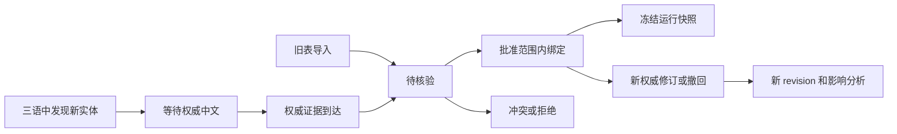

# Term Ledger v2：适合本项目的术语资产格式与维护流程

> 2026-09-29，设计稿，未实现。返回[总路线图](2026-09-29-future-capability-roadmap.md)。本规范中的路径、字段、命令和示例都是未来接口；本次不创建真实词库、不迁移既有数据。

## 1. 设计决定

术语的主键是稳定的“实体＋含义”，不是韩文字符串。一条 `이상` 可以对应人物姓名或数量关系；同一实体也可以有 KR/JP/EN 多个形式。权威中文的形式和适用范围必须单独表达。

采用“人工编辑 YAML＋机器交换 JSONL＋不可变运行 JSON”三种投影，各有明确职责：

| 层 | 拟议格式 | 为什么 |
|---|---|---|
| 已审词条源文件 | UTF-8 YAML，每个 term_id 一个文件，按实体类型分目录 | 方便维护多语别名、条件和证据；Git 差异局部；不要求人在一条很长的 JSONL 上改范围 |
| 候选、证据、审阅事件 | 分批不可变 JSONL＋manifest | 适合自动增量提取，保留所有竞争解释；候选使用独立 schema |
| 运行术语快照 | 按 ID 排序的 canonical JSON＋SHA-256 | 只包含可使用的权威约束；并发只读、可回放 |
| 查询索引 | SQLite，AC 索引/词面索引 | 由源文件和证据重建；不是唯一持久化来源，也不将 SQLite 二进制频繁提交 Git |
| 审阅视图 | Markdown/HTML、可选 CSV/XLSX 导出 | 展示四语证据和变更影响；表格导入只产生 proposal，不能直接改变运行词库 |

YAML 当前版本内容可经审阅修改；历史由 Git 提交、不可变证据和快照保存。不是在同一 JSONL 中无限追加同 ID 然后靠“最后一行获胜”。每个运行快照内一个 `(term_id, revision)` 只能出现一次。

拟议目录：

```text
terminology/
  manifest.yaml
  sources.yaml
  entries/{character,status,skill,place,org,item,concept}/*.yaml
  decisions/*.jsonl
  legacy-imports/*.manifest.json
knowledge-snapshots/<snapshot_id>/
  manifest.json
  terms.runtime.json
  evidence/*.jsonl
  candidates/*.jsonl
  lineage/*.jsonl
```

第一组是仓库中审阅过的文本资产；第二组是独立的不可变知识快照资产。不会放进玩家游戏 JSON，Actions 缓存也不能成为它的唯一副本。

## 2. 权威资格与处理状态必须分开

### 2.1 定义四个独立维度

| 维度 | 值 | 用途 |
|---|---|---|
| `origin.actor` | `human` / `extractor` / `llm` / `legacy_import` | 谁提出这条记录；不决定内容是否权威 |
| `source.kind` | `authority_release` / `authority_commit_candidate` / `legacy_glossary` / `raw_source` / `project_machine_output` | 证据从哪里来；字段级，不只看仓库名 |
| `review.state` | `pending` / `approved` / `rejected` / `conflict` | 记录是否完成规定的审核 |
| `lifecycle.state` | `active` / `superseded` / `withdrawn` | 当前是否有效，过去是否使用过 |

LLM 可以从真实权威中文中**抽取**一个字符串。这时 proposer 是 `llm`，中文证据仍来自 `authority_release`；程序核对 span、来源及审核后可以入库。反之，LLM 自己写出中文，即使人觉得合理、模型多次一致、Jev 给 0.99，也没有权威中文证据。

### 2.2 编译为运行约束的必要条件

必须同时满足：

1. `review.state=approved` 且 `lifecycle.state=active`。
2. `target.zh-Hans.preferred` 和每个 allowed form 都能追溯到被来源策略接纳的中文证据。
3. 证据不是本项目机器输出；提取出来的目标片段确实存在于证据正文。
4. 原文和权威中文的时间/版本对齐已确认；或是有同等可复核依据的人工对齐确认。
5. 实体、sense、范围有界且没有未解决的权威冲突。
6. schema、哈希、引用、跨度、版本兼容性全部通过。

两条准入通道：A 为来源策略已确认、稳定 ID 名称字段与原文版本准确对应的确定性提取，可由固定规则审批；B 为正文片段、别名、合并、跨域规则扩展，需要人工确认证据。两者都不能把“模型判断正确”当权威来源。

`approved` 不会自动赐予权威资格。人工接受一个无权威依据的临时译名只产生“临时译文审核记录”，仍不进运行术语库。首次版本不提供绕开此条件的 `force_authoritative` 开关。

## 3. 词条 schema

### 3.1 完整结构示例

下例是**虚构的结构示意**；编号、词语和 SHA 占位符都不是实际游戏/LLC 事实，不能直接编译为生产词条。

```yaml
schema_version: 2
term_id: lcta.status.demo_horizon
revision: 1
entity:
  kind: status
  namespace: battle_keyword
  keys:
    - {domain: base, id: DemoHorizon}
sense:
  id: combat_status
  description: 示例战斗状态名
source_forms:
  ko:
    - form_id: ko.canonical
      text: 지평
      role: canonical
      case_sensitive: true
      match: {mode: literal, boundary: token_or_known_particle, normalization: nfc}
      evidence_ids: [ev.demo.name]
  ja:
    - form_id: ja.canonical
      text: 地平
      role: canonical
      case_sensitive: true
      match: {mode: literal, boundary: contextual, normalization: nfc}
      evidence_ids: [ev.demo.name]
  en:
    - form_id: en.canonical
      text: Horizon
      role: canonical
      case_sensitive: false
      match: {mode: literal, boundary: word, normalization: nfc}
      evidence_ids: [ev.demo.name]
target:
  zh-Hans:
    preferred: 地平
    enforcement: exact
    allowed_forms: []
    forbidden_forms:
      - {text: 地平线, reason: 示例旧机译，仅在本词条适用位置禁用}
    evidence_ids: [ev.demo.name]
    surface_policy: preserve_authority
scope:
  any_of:
    - all_of:
        - {field: entity.namespace, op: eq, value: battle_keyword}
        - {field: entity.id, op: eq, value: DemoHorizon}
    - all_of:
        - {field: text_type, op: in, value: [skill_desc, passive_desc]}
        - {field: protected_reference_ids, op: contains, value: DemoHorizon}
  exclude: []
relations: []
notes:
  local: 只在已确认引用该状态时使用；普通叙述中的同形词不自动命中
  maintenance: 示例条目，请勿导入
origin:
  actor: extractor
  method: structured_name_alignment
  tool_version: extractor-v2
review:
  state: approved
  decision_id: decision.demo.approve
lifecycle:
  state: active
  introduced_snapshot: authority.demo.r1
  applicability_id: applicability.demo.r1
  supersedes: []
  replaced_by: []
```

### 3.2 规范字段与默认行为

| 字段 | 规则 |
|---|---|
| `schema_version` | 必填整数 2；不接受自动猜版本 |
| `term_id` | 全局稳定，限定小写 ASCII、数字、`.`、`_`、`-`；不由某个语言表面字符串直接生成；改译名不换 ID |
| `revision` | 正整数单调递增；改 scope、form、target、证据资格都要递增 |
| `entity.kind` | 受控枚举 `character/status/skill/place/org/item/concept`；必要时由 schema 升版增加 |
| `entity.keys` | 结构化对象允许多个 `(namespace/domain/id)`；不是所有游戏 ID 都在全游戏唯一；没有 ID 的概念允许空数组 |
| `sense.id` | 词条内稳定义项；不同含义建不同 term_id，以 `different_sense` 关联 |
| `source_forms` | 使用 `ko/ja/en`，适配现有目录 `KR/JP/EN`；至少一种非空；缺失语言用空数组，绝不拿 KR 填 JP/EN |
| `form_id` | 同词条内稳定；命中记录引用它，以保留昵称、全称、敬称的区别 |
| `role` | `canonical/alias/title/abbreviation`；不同称呼可有独立形式约束，不自动一律替成全名 |
| `match.mode` | 初期只允许 `literal`；不把任意 regex 放进维护格式。后续若增加 regex，另建受控且有复杂度限制的 schema |
| `match.boundary` | `exact_field/word/token_or_known_particle/contextual`；CJK 短词默认 contextual，无缺省“任意子串即适用” |
| `target.zh-Hans` | 目标对象；source-only 实体允许 `target: null`，但不会编译为中文约束 |
| `enforcement` | `exact/allowed_forms/contextual`。不采用中文默认 inflectable；昵称、简称、空白容许以可审计表面规则表达 |
| `allowed_forms` | 数组项 `{text,evidence_ids,scope}`；每个形式有独立证据；为空不代表允许任意改写 |
| `forbidden_forms` | 只在该词条适用位置有效；不能把“地平线”全项目禁止 |
| `surface_policy` | `preserve_authority` 或已版本化受控规则 ID；默认逐字保留，不无条件简繁/全角/标点转换 |
| `scope` | 必填；缺失报错。`any_of: []` 表示无可自动适用范围，绝不等于全局；显式全局须专门规则及审核 |
| `relations` | `{type,term_id,evidence_ids}`，type 为 `alias_of/same_entity/different_sense/contains/related_to`；“相似”不能隐式合并 |
| `notes.local` | 可进入局部提示的已证实事实，限制长度；scope 的机器语义不能只写在这段自然语言中 |
| `notes.maintenance` | 维护笔记，不进入翻译提示 |
| `review/lifecycle` | 必填；不接受无审阅状态的旧表悄然按 approved 解析 |

语言代码统一：`ko=KR`、`ja=JP`、`en=EN`、`zh-Hans=LLC_zh-CN`。首次引入时一次性适配；对外包内文件名保持游戏要求。

形式约束的精确定义：`exact` 只接受 preferred（再按 surface_policy 比较）；`allowed_forms` 接受 preferred 加满足各自 scope 的显式形式，且必须至少列出一个补充形式；`contextual` 只提供权威表达参考，不凭字面缺词判强错误。昵称、称号若应使用不同中文，用 allowed form 的 `source_form_id` 条件或独立称号词条表达，不能因为属于同一人物就一律改成全名。

### 3.3 scope 表达式

只允许受控字段和操作符：

- 字段：`entity.namespace/entity.id/entity.domain`、`source_form_id`、`text_type`、`logical_path`、`field_role`、`chapter_id`、`speaker_id`、`addressee_id`、`protected_reference_ids`、`sense_evidence_ids`。
- 操作：`eq`、`in`、`contains`；路径匹配另用有边界的 `path_glob`，不执行代码。
- `any_of` 是 OR；组内 `all_of` 是 AND；任一 exclude 组成立则排除。
- 缺失所需元数据返回 `unknown`，不是 false 或 true。unknown 进入判定/审阅，不能据此强制中文。
- 范围更具体只在能证明谓词包含关系且证据不冲突时优先；无法比较时保留多个候选。不能简单按“字段多”或文件排序择一。

先召回所有候选 span，再应用范围/长词优先/实体约束；同一 KR 可以同时召回多个 sense。禁止以 `(kr -> dict)` 去重抹掉多义。

scope 满足只表示候选允许在该场景出现，不证明该字段每个同形词都指向它。例如字段里有 `[DemoHorizon]`，不能因此把另一个普通“地平”也强制定译；最终应用仍须 occurrence 的实体/含义证据。

## 4. 原文、中文与证据记录

### 4.1 `EvidenceRecord`

| 字段 | 内容 |
|---|---|
| `schema_version/evidence_id` | 版本和内容寻址 ID；同内容重复抓取不重复计证据 |
| `source_refs` | 分别引用 KR/JP/EN/中文 source snapshot；每个 snapshot 保存 raw token 或 repo SHA/Release asset ID、文件哈希、内容哈希 |
| `unit_identity` | 逻辑文件、实体 namespace/id、字段角色/选择器；另存各语言实际 JSON Pointer |
| `languages` | 每语 `{text,raw_sha256,state,span}`；缺失用 `text:null,state:missing` |
| `span` | 每个抽取片段在原始解码文本中的 Unicode code point 半开区间 `[start,end)`，并存 `quote`；`text[start:end] == quote` 必须成立 |
| `alignment` | 方法、已核对的稳定键、版本依据、状态 `verified/candidate/conflict/unresolved`，不是模型 confidence 的改名 |
| `applicability_id` | 对应原文版本/有效区间证明；可引用原文沿版本不变的连续链 |
| `duplicate_group_id` | 同字段重复发布、同句复制、同提取重试的去重分组 |
| `assessment` | 判定器版本、问题版本、输出、理由/结构性规则 ID；只是辅助证据 |
| `observed_at/source_published_at` | 接收时间和来源发布时间分开，UTC ISO-8601；不作为自动语义对齐依据 |

完整名称字段只证明该字段的实体名称。不能仅因 `name` 对应成功，就把同 KR 短词所有正文位置的译法也确认为相同。

中文证据保留实际原字形；用于检索的 NFC 等派生文本另存及版本化。原始 UTF-8 文件 hash 与解码字段文本 hash 是两种字段，不混用。

### 4.2 候选 schema 独立

`TermCandidate` 不允许携带运行 `enforcement` 或 `approved` 标志，避免伪装成正式词条。至少包含：

```json
{
  "schema_version": 2,
  "candidate_id": "candidate.demo.001",
  "origin": "machine_generated",
  "proposed_entity": {"kind": "status", "id": "DemoHorizon"},
  "source_spans": [{"evidence_id": "ev.demo.raw", "lang": "ko", "quote": "지평", "start": 0, "end": 2}],
  "proposed_zh": "地平线",
  "target_origin": "generated",
  "evidence_ids": ["ev.demo.raw"],
  "status": "awaiting_authority",
  "observations": {"count": 3, "independent_evidence_groups": 1},
  "runtime_eligible": false
}
```

这是虚构示例。`target_origin` 为 `generated` 时，任何票数都不改变 `runtime_eligible=false`。从权威正文提取的候选改为 `extracted_authority`，必须提供 target span，仍需走第 2 节准入。

候选状态为 `awaiting_authority/awaiting_review/conflict/rejected/resolved`；解决时保留 candidate，新增 `resolved_to={term_id,revision}`。如果权威中文后来恰巧与机译相同，仍必须新增权威证据并重新准入，不能把旧机器证据改标签。

### 4.3 决策事件

每条 `DecisionEvent` 包含 `decision_id, actor, action, subject_id, expected_revision, evidence_ids, reason, created_at, policy_version`。

- `action` 为一个枚举值：`approve_binding/reject_candidate/change_scope/link_entities/split_entity/supersede/withdraw`；不是用竖线拼起来的字面字符串。
- 人工与确定性提取器都使用比较并交换：`expected_revision` 不匹配则重新审阅差异，禁止覆盖别人刚改的词条。
- 模型只有 `propose` 能力，没有提交 `approve_binding` 的权限。
- `approve_binding` 的事件必须引用真实 authority evidence；`split_entity` 更新关联和使用索引，不删除旧 ID。

## 5. 生命周期、修订与撤回



状态的推移不等同于删除历史。权威 revision 2 到达时：

1. 核对同一实体、sense、原文适用版本和范围。
2. 记录 authority 中文修订；新 revision 引用旧 revision，旧快照仍可重放。
3. 将旧名写成范围内 `forbidden_form` 仅在确有弃用依据时执行；若只是称呼差别，保留不同 scope。
4. 失效所有引用旧 binding 的机器译文、机译结果缓存和相关判定缓存。
5. 生成影响报告；新输出优先使用新 authority，历史包不被静默替换。
6. 权威源回退/撤回时标记 snapshot withdrawn；只按已批准回滚策略恢复最近兼容权威，否则转待处理，不能选机器候选补空。

没有原文版本证明的“最新中文”，不能自动废弃仍适用于旧语义的译名。`introduced_snapshot` 与 `applicability_id` 分工不同：前者是我们何时知道它，后者是它适用于什么文本。

## 6. 编译与运行投影

输入：已审 YAML、来源策略版本、证据 manifest、原文/authority snapshot、scope/schema 版本。

编译步骤：

1. 严格解析：禁用 YAML 任意对象构造/自定义 tag/merge key；拒绝重复 key、隐式日期转换和未知字段；所有 ID 明确作为字符串。
2. 校验实体引用、语言形式、字符区间、SHA、scope 和状态组合。
3. 按第 2 节判断 binding 是否可进入运行；输出排除原因和计数。
4. 编译三语 forms 的候选索引及中文形式校验索引，保留 `term_id/revision/form_id`，不压平成 KR 单值字典。
5. 输出 canonical JSON：UTF-8、字段名排序、数组按定义排序、固定换行与序列化版本。JSON 数组若具有语义顺序，不擅自排序。
6. 保存 `content_sha256`；timestamp 等非语义数据放 manifest，不能让同内容每次编译都产生新语义快照。

`terms.runtime.json` 包含可用绑定、实体元数据、范围、匹配规则、证据 ID 和版本；不包含候选 `proposed_zh`、维护笔记或旧机器译文。

所有普通术语、角色表、状态效果名、词典、few-shot、风格样本、缓存和场景摘要走同一来源检查。检查器与提示构建器共用 `ResolvedOccurrence` 和 snapshot，避免一边认为适用、另一边认为不适用。

不为旧核心导出有损的全局单值表。过渡适配器只导出“在当前字段明确唯一”的小集合；遇到 scope、多义或证据未知，必须进入新解析接口或回退为无术语约束，不丢字段。

## 7. 旧词表迁移实例

以下源条目引自 [2026-09-25 静态词表观察](2026-09-25-architecture-terminology-jev-session.md)。观察不等于本次确认译名为最新权威。

| 旧条目 | 迁移策略 |
|---|---|
| `사 → 巳` | 建地支/黑兽分支 sense 的待核验记录；明确短词边界及 `사색` 反例，不能裸匹配全局启用 |
| `이상 → 李箱`，note 另写“不低于” | 人物词条与数值比较规则分开；比较义通常是机制语义规则，无须伪装成人名术语 |
| `피주머니 → 血袋(间章名词)/血囊(BUFF译名)` | 拆为两个 scope/sense 候选，分别找对应 authority evidence；中文括号和斜线绝不作为一个目标词注入 |
| `호위무사 → 护卫武士 / 侍卫` | 建公司/章节范围约束；没有元数据证明 S/H 公司时返回 unknown，不能按第一个中文取值 |
| `proper_learned.json` | 全部移入隔离候选，保留原 votes/sources，但统计不是权威证明 |
| 本轮角色/效果输出 | 先保留三语 entity 事实；中文逐字段追踪 authority/generated，没有 provenance 的中文按未知处理 |

旧表导入为 `legacy_unverified` 的候选批次。保留原 JSON 字节、响应元数据和导入映射；不要将“曾经人工维护”自动等同“现在仍符合权威译法”。首次生产切换前，可先核验高频角色/效果；无法证实的记录继续待审，覆盖率下降作为可见指标。

这里的 `legacy_unverified` 是导入批次的资格标签，不是新增的 `review.state` 枚举；其中候选仍使用 `status=awaiting_review`，来源 evidence 的 kind 为 `legacy_glossary`。source-only 实体可以保留在独立实体索引中，未确认的中文绝不随之进入运行绑定。

导入报告必须可对账：每条旧记录映射至 0/1/N 个候选或词条，并给出原因；相同表重复导入不得增加支持票或 duplicate 候选。

## 8. 持续维护流程

1. **原文更新**：扫描新增/变化的实体、三语名词和关系，优先结构化名称；登记“待权威”的实体，机器临时译名只作诊断。
2. **权威更新**：准确对齐后提取名称、译名修订、正文专名片段；未变字段不重复计票。
3. **程序清洗**：验证片段存在、类型、占位符、重叠、范围和已有实体冲突。近似形式只给合并建议。
4. **优先队列**：权威冲突/撤回 > 高使用量名称 > 影响多文件的变更 > 普通候选；显示影响字段数、已发布包数和候选等待时长。
5. **审阅**：并排展示 KR/JP/EN/中文、来源版本、跨度、旧/新译名、冲突和历史；操作为接受证据绑定、缩小范围、拆义、链接、拒绝、等待权威。
6. **编译快照**：审核之后统一冻结；正在翻译的任务保持旧快照，新批次采用新快照。
7. **影响分析**：反向索引找到已生成机器字段，提交修订任务；保存修订覆盖率和未覆盖原因。

初期做 CLI 生成 Markdown/JSON 审阅包＋Git 审阅，后期再做四语审阅页面。没有维护者处理某条候选时，系统继续使用已有权威词条并报告未知名，不能以队列积压为理由自动接纳机译。

维护命令设计为 `terms import-legacy/propose/lint/review/compile/diff/impact`；默认 dry-run，实际实现时写入必须显式选择动作。这是产品接口计划，本次没有创建或运行这些命令。

## 9. schema 验收条件

- 机器候选以任意文件名伪装输入都不能进入运行词库。
- `approved` 但 authority evidence 不完整必须编译失败或明确隔离，不能静默通过。
- 缺少 JP/EN 不伪造；同 KR 多义、同实体多别名可无损往返。
- 新旧 scope 有重叠冲突时产生明确报告；空 scope 不变成全局。
- 历史字形、raw 指纹、target span、决策链和候选输赢均可追踪。
- 连续两次编译相同语义输入得到同一 content hash；随机化文件顺序不改变快照。
- 词条撤回或证据失效能找到所有直接和间接引用；无来源的缓存不能绕过准入。
