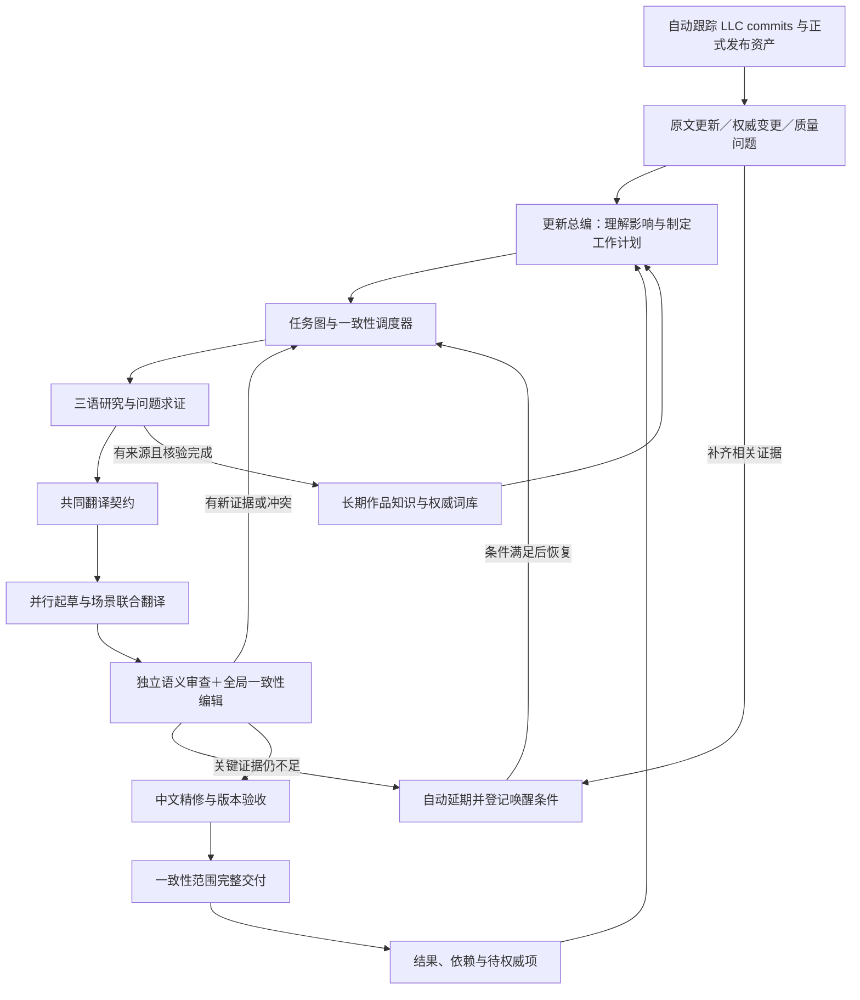

# LCTA v2 总体思路与功能蓝图

> 2026-09-30 · 设计方案，尚未实施
>
> [纲领](lcta-v2-manifesto.md)规定目标，[顺序执行计划](lcta-v2-plan/README.md)规定怎样建设。本文描述目标系统，不预先钉死类名、数据库表、具体提示词和供应商型号。

## 1. 主体结构：长期作品知识＋每轮 AI 编辑部

系统由两部分组成：

**长期作品知识**保存实体、三语资料、权威中文、角色与称呼关系、机制表达和已核验决定。它通过原文、LLC 提交与正式发布资产的自动采集持续更新。

**每轮 AI 编辑部**接到变化后研究影响、形成任务、组织协作、生成候选、裁决冲突、完成定稿。它可以主动拆解和追加研究任务，但不能直接改写长期权威事实或绕开发布验收。

两部分由事件、任务图和版本化的共享工作区连接。整个系统可以在 CI 中完成一次更新，也能恢复长任务；没有必要一开始拆成多套微服务或引入外部 Agent 框架。配置完成后无需人工操作，控制台关闭也不影响采集、研究、裁决、修订和发布。

## 2. 工作对象：语义关系决定怎样分组

### 2.1 三个尺度

| 尺度 | 对象 | 主要作用 |
|---|---|---|
| 作品 | 实体、世界观、角色关系、全局机制、历代权威用语 | 决定长期一致性 |
| 一致性域 | 一段场景、同一新实体的相关文本、一族机制、互相关联的 UI | 决定共同研究、联合审校和交付边界 |
| 翻译单元 | 一个可回写字段或有稳定身份的片段 | 决定精确定位、编辑和游戏格式 |

“一致性域”是需要共同满足某些决定的文本集合。它可以跨文件，也可以只覆盖一个文件中的一部分；不是简单把全部有共同人名的文本连成一个巨大任务。

对全游戏高频实体，已稳定决定作为可读契约供各域引用；只有该决定发生变化时才追踪其依赖。存在循环依赖的新内容先作为联合研究组解决，不让任务图互相等待。

### 2.2 作品关系图的用途

关系图回答：这些字段是否谈同一个人；同一个状态是否在名称、描述、技能引用里有不同表达；角色之间如何称呼；这次修订将影响哪些旧机器译文。

它首先是领域模型，可以落在普通持久化存储中；不要求为“图”这个概念立刻上图数据库。AI 提出关系，程序检查身份与来源，存在歧义时保留多个解释。

## 3. AI 工作角色与协作方式

| 工作角色 | 负责什么 | 应交付什么 | 不拥有的权限 |
|---|---|---|---|
| 更新总编 | 判断影响、划分一致性域、安排研究和复核 | 工作计划、共同依赖、待决问题 | 不能跳过验收直接发布 |
| 三语研究员 | 分别理解 KR/JP/EN，发现差异与原意证据 | 语义说明、引用、分歧与未确定项 | 不能以多数票改写原意 |
| 术语与资料编辑 | 研究权威译法、识别实体与范围、整理自有词库 | 证据绑定、词条提案、称呼/机制约定 | 不能把机器造名升级为权威 |
| 领域译者 | 按共同契约翻译场景、机制或 UI | 完整候选与需要复核的决定 | 不能自行修改公共约定 |
| 原意审查员 | 独立核对遗漏、增写、指代、条件、数字、时序 | 有证据的反例和支持结果 | 不能只凭“不够自然”改原意 |
| 一致性编辑 | 比较全域/全局候选，识别真正矛盾 | 冲突案件、可执行修订要求 | 不能用表面相同代替同义判断 |
| 中文编辑 | 自然度、节奏、人物声音和语域 | 保持意思的编辑候选 | 不能创造新事实、暗改术语 |
| 裁决者 | 综合证据选择决定，必要时要求新研究 | 有适用范围的裁决、未解项 | 不能用角色数量当权威票数 |

角色是任务契约和权限，不要求每句都启动八个 Agent，也不要求八种模型。通常由同一服务的隔离调用承担；高影响争议才追加独立读解或不同模型。评估关注核验增益而不是角色数量。

**协作靠成果和案件，不靠无限群聊。** 工作区保存语义说明、契约、候选、反例与裁决。AI 可以请求查资料、对齐邻接文本、检查使用位置；运行时将请求转成受控任务。工具只读取允许的原文和知识、提出变更，不开放任意发布和写权威词库能力。

## 4. 三语从参考资料升级为共同理解过程

1. **识别真正的平行文本。** 同路径不是充分条件；剧情插行、等级变化、错版对照需先处理。
2. **建立三语语义说明。** 明确参与者、行为、对象、条件、否定、数量、时序、语气和可能双关。机制文本与文学文本采用不同的说明方式，不强迫所有内容塞成公式。
3. **保留差异。** KR 通常是游戏原意基准，JP/EN 提供额外线索；出现官方语种冲突时，不让多数票代替求证。
4. **必要时分开阅读。** 对高风险歧义，先独立读解再比较，降低共同提示导致的锚定偏差；普通内容使用联合理解以避免不必要重复。
5. **主动补充上下文。** 发现“谁对谁说”“触发先后”不清楚时，生成研究任务，而非让翻译器猜。
6. **形成共享理解。** 多个译者读取同一已核验说明，减少同一实体或规则被各自理解一次造成的漂移。

这里的说明是可核验的结论、引用和未解项，不要求模型提供私有思维链。中文是否写得好和原意是否理解对分开评价。

## 5. 一致性契约：真正共享的是决定及其依据

每个一致性域在起草前形成编辑契约，内容包括：

- 出场实体、适用权威译名和不能混淆的同形词。
- 角色称呼、叙述人称、语域、标点及机制表达习惯。
- 原意不确定项、语言差异、当前不能自动决定的地方。
- 可直接采用的权威整句，与只能参考的相似例句。
- 有权编辑的字段及不得损坏的游戏结构。

契约有范围、来源和版本。译者发现反例可以申请重开某项；裁决通过后只使相关任务失效，调度器安排同步修订。正在运行的任务不会悄然读到“半个新词表”。

### 未发布权威译名的新实体

需要共同处理其所有相关文本，而不是先翻一个文件再拿该译名强制其他文件。

允许 AI 在**同一编辑任务内**对一组临时草稿联合比较、选择和修订一致的表达；草稿共享不意味着已证实。临时译名必须标明待权威，不能成为其他独立任务的固定术语、权威 TM 或事实证明。下一次更新如需继续采用，必须重新检查原文与是否已有权威，不以“以前这么译过”为正确性依据。

如果该名字的身份/含义仍可能理解错，先自动补证和独立核验；仍无法可靠决定则延期该范围，登记后续证据到达后的自动重启条件。不能为了统一或无人值守而强制一个错误名称。权威到达后可整体替换、重新审校。机器输出可以是被审阅的对象，不能成为证明自身正确的证据。

## 6. 自有知识系统与术语格式

建立四类互相区分的记忆：

| 类别 | 保存什么 | 何时可用 |
|---|---|---|
| 权威资产 | LLC 正式中文、可靠对齐句对、核验术语和权威修订 | 在证据对应版本和适用范围内使用 |
| 原文知识 | 三语实体、关系、机制、场景事实、已核验理解 | 有原文引用且冲突已处理，可自动供理解使用 |
| 编辑工作记忆 | 当轮契约、临时草稿、争议、候选和裁决 | 在明确任务/版本内工作，不变成长期定译 |
| 经验与评测 | 失败类别、审阅修正、角色效果、可复现案例 | 改善工作方法，不能直接修改原意或捏造术语 |

术语格式围绕“实体—义项—三语形式—中文权威形式—适用范围—证据—修订史”设计。使用适合自动维护和人工阅读的格式与可编译运行视图，旧三列词表只是导入材料。每项证据可定位到仓库 commit 或发布资产、路径、字段与源文版本。格式细化在任务 05，当前不让 schema 设计主导整个重构。

检索同时支持结构化实体、准确词面和语义检索；可使用向量召回来提升资料发现能力。但语义近邻只能带来参考材料，不能把类似技能、不同条件或不同角色的句子直接复制成答案。检索器还必须能回答“没有足够证据”。

### LLC 提交驱动的知识生产

自动跟踪 `LocalizeLimbusCompany/LocalizeLimbusCompany` 的可信分支和发布引用。首轮建立可恢复的历史基线，之后按提交关系增量获取，读取变化前后的实际文件，按字段和实体整理补译、改名、称呼调整、机制修正及撤回。

AI 负责从变更中发现语义关系与修订含义；程序负责提交完整性、来源、引用、结构和版本核对。通过核验后自动更新术语、权威句对和相关知识，再触发重编辑。无法证明的条目保持有条件待证，生产链不需要维护者逐条确认。

commit 与正式发布独立追踪：未发布内容保留上游待确认身份，不自动等同正式权威；发布资产比源码更新时，直接从资产补齐权威内容。两者只有在实际内容或可靠发布映射吻合时才绑定，不能仅凭 tag 的目标分支就声称资产来自同一文本版本。具体流程见[任务 05](lcta-v2-plan/05-authority-and-terminology.md)。

## 7. 调度重建：把有限能力投入最影响全局的地方

### 7.1 持久工作图

原文变化、LLC 提交、权威补齐、词条修订和 AI 发现冲突都能触发任务。定时检查为基本自动触发方式，可加可用的事件通知；没有上游 webhook 权限也能持续运行。一次进程退出不意味着任务丢失。任务区分研究、理解、定约、起草、审查、裁决、修订与发布准备，不再都叫一次“翻译调用”。

任务显式记录依赖和产物，支持动态追加子任务、暂停、恢复、取消过时工作和局部重算。基础运行机制由程序掌握，AI 只提出工作计划和需求。

### 7.2 优先策略

- 先解决影响多个下游任务的实体歧义和共同术语。
- 在共同约定固定后，并行不同场景和互不冲突的内容。
- 给高影响、证据冲突和游戏机制错误分配更多研究/复核能力。
- 简单权威复用不必经过整套生成角色。
- 主动限制争议任务占满全部资源，保留新版本和权威修订的执行机会。
- 遇到预算不足，延后低优先工作；不静默删除必要审查、改用未验证模型或裁掉原文关键信息。
- 同一一致性域的变更一起完成验收，不把同一实体的新旧译名拼到一个版本中。
- 无新证据的争议自动休眠；根据相关提交、权威、原文变化或已验证策略更新唤醒，定时复查不会无条件重跑同一争议。

并发优化要有语义理由：它改变的是等待关系和资源利用，不是翻译标准。

## 8. 全局编辑闭环与信达雅

草稿进入两种相互独立的检查：

**原意检查**寻找错误解释、遗漏、增写、指代错位、机制变化；可由程序确定的数字/引用/格式同时由程序核验。

**一致性检查**跨文本寻找同实体异名、同机制异说、角色称呼漂移、同样场景语域不稳、复用与新生成冲突。允许合理变体，不能把字面相似度当裁判。

每个问题形成“案件”：影响范围、冲突候选、源文证据、可能解释、需要补充的资料。裁决者可以要求重新阅读或扩大场景，而不是只选最流畅的一句。裁决后调度相关修订，再核验整个影响范围。

信达雅编辑发生在原意与共同决定明确之后。中文编辑可以重组句子、改善节奏和角色声音；修改产生新的候选，仍需检查意思和已批准约定是否改变。没有新证据的重复改写应停止，不能无限润色至漂移。

## 9. 自有模型请求基础

新版本生产依赖中不再包含 translatekit，也不继承它的 TranslatorBase、服务注册表、提示词设置方法或异常层次。

- 通过自有薄 HTTP 客户端直连 OpenAI 兼容的 Chat Completions 接口。
- 管理模型配置、能力声明、结构化结果、连接/流式状态、重试、用量和调用追踪。
- 同一任务可以选择适合该角色的模型，但必须经过该角色的数据验证；不自动把“便宜”等同“适合简单任务”。
- OpenAI 兼容不等于支持全部 OpenAI 功能。严格结构化输出、工具调用、参数、上下文限制等按端点能力验证。
- 若以后需要 Responses 或其他协议，新增显式适配器，不要求通用兼容服务支持它。
- Jev 保留为待验证的有限判断加速器，不作为新架构中心；原集成可删除，达到实际收益后再以独立 HTTP 插件接入。其专用协议不能冒充 Chat Completions。

完整边界见[任务 02](lcta-v2-plan/02-direct-model-runtime.md)。

## 10. 权威迟到不是补丁，而是常态工作

新原文形成的机器译文天然有“待权威”部分。系统要主动维护受影响实体和译文的关系，中文更新到来后重新发起编辑工作。

改变不局限于术语字符串：新权威可能暴露之前人物理解、句式习惯、称呼关系或机制解释不正确。系统应找出相关决定及其下游文本，重新研究和定稿。

原文 token 未变也要工作；新中文同标签重传也要识别。发布以前的产物保持可追溯，新发行内容采用更新后的共同决定。系统修复的是有来源的依赖关系，不是全目录搜索替换。

## 11. 无人值守运行与观测台

生产流程没有“等人工审批”或“交人裁决”状态。可处理问题自动解决，证据不足自动延期，暂时故障按预算重试；发布由验收结果自动驱动。部署时需要提供有效的凭据、来源和资源配置，运行中不能依靠维护者定期点击继续。

观测台提供本轮更新总览、LLC 提交处理进度、AI 工作与阻塞关系、四语证据对照、术语/角色卡、冲突案件、修订差异、发布状态和自动唤醒条件。每个“为什么这样译”能追溯到具体证据与决定。

人可以自愿查看或提供纠错线索，但这些操作不属于正常流程的必要步骤。未解决问题留有记录并继续等待有效事件，不能靠降低质量门槛或自动忽略错误制造“全绿”。

## 12. 建设顺序与主要交付

| 波次 | 执行任务 | 形成的能力 |
|---|---|---|
| A 新执行基础 | 01–03 | 明确新系统契约、直连模型、可恢复工作图 |
| B 共同理解与决定 | 04–07 | 三语理解、LLC 提交整理、自动权威词库、AI 编辑部与分层记忆 |
| C 一致性生产 | 08–11 | 动态调度、联合起草、全局裁决、信达雅编辑 |
| D 持续运行与替代 | 12–14 | 权威收敛、无人值守运维与观测、完整验证与旧核心退役 |

评测从任务 01 开始，原意核验从理解和生成入口开始；最后一波做的是整体验收，不是到最后才关心质量。

## 13. 参考材料如何使用

依据保留的[GitHub 调研](2026-09-26-github-translation-consistency-survey.md)、[三语与术语讨论](2026-09-25-architecture-terminology-jev-session.md)、[Jev 归档](2026-09-26-jevs-stage0-disambiguation-implementation.md)和[权威收敛分析](converge-to-authority.md)。

- 借鉴 prozetta 的共同作品档案，但扩展为会因证据变化而重开决定的编辑系统。
- 借鉴 ATT 的稳定任务与明确验收，把边界提升到跨文件一致性域。
- 借鉴 LinguaGacha 的关系发现、角色约束与审校，补足权威迟到和长期来源治理。
- 借鉴 translation-workbench 的工作交接，让 AI 按可审查成果协作。
- 借鉴翻译记忆和三库检索设计，但不限制新系统只能使用精确子串。
- 不继承“模型发现译名就永久加入词表”、固定多轮自评或“先成功的文件决定后面怎么译”。

这份方案吸收可用机制，不承诺复制任何外部框架；也不让旧项目的局限成为新系统的上限。
